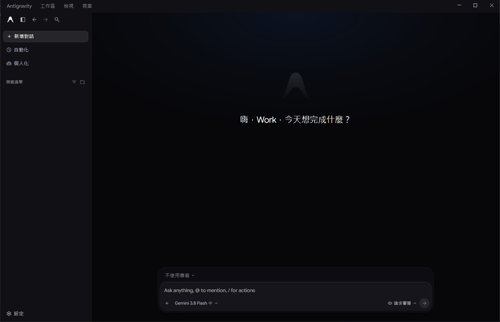
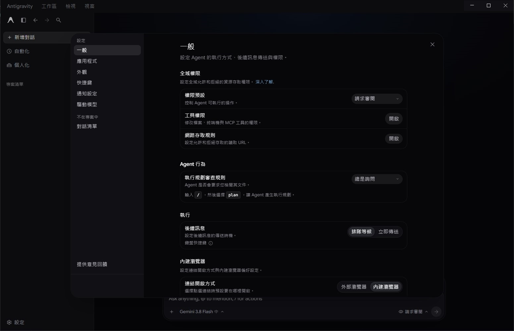
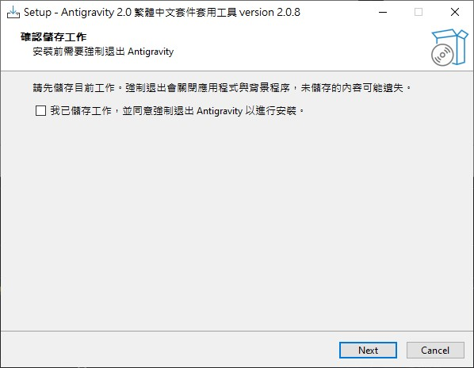
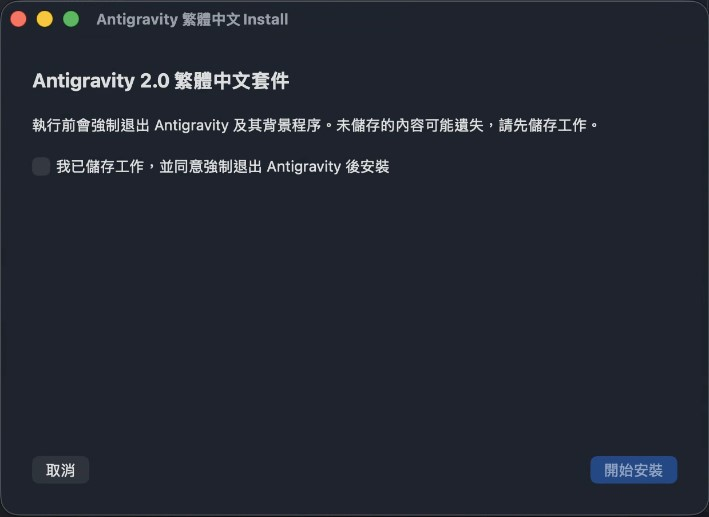

# Antigravity 2.0 繁體中文套件

**請先選擇安裝方式。兩種方式都需要先安裝 [Node.js LTS](https://nodejs.org/)（包含 npm）。**

| 安裝方式 | 版本與平台 | 使用者需要做的事 |
|----------|------------|------------------|
| **傳統版** | v1.0.16，Windows／macOS | 下載 zip 或 Git Clone，**⚠️ 首次安裝及每次更新本套件後，先手動執行 `npm install`**，再執行安裝或還原腳本。 |
| **圖形化版** | v2.0.9，Windows／macOS | 下載對應安裝器，執行圖形化安裝或還原；**⚠️ 不需使用者手動執行 npm 指令**。 |

將 Antigravity 2.0 的介面翻譯為繁體中文（台灣）。翻譯字典以 Antigravity 2.0 v2.34.0 介面為基準。請依照下方對應的操作區塊安裝與還原。

Antigravity 2.0 Traditional Chinese Localization Toolkit is a source-available project that translates the Antigravity 2.0 interface into Traditional Chinese. It works by unpacking and repacking the local Electron ASAR file, without modifying official core binaries or redistributing any official Antigravity files. The toolkit supports Windows and macOS, automatically creates backups, runs entirely on the user’s local machine, and avoids translating code editors, terminals, input fields, debug consoles, and other areas where localization could interfere with development workflows.

## 簡介

**Antigravity 2.0 繁體中文套件**是一套公開且免費的介面本地化工具，透過 ASAR 展開與重新打包機制，將 Antigravity 2.0 的英文介面翻譯為繁體中文。

本次翻譯字典以 Antigravity 2.0 v2.34.0 介面為基準，建議安裝本套件最新版。

- 不修改官方核心二進位檔案
- 不散布官方 `app.asar` 或任何官方檔案
- 依所選方式安裝後，可使用對應的腳本或圖形化還原工具回復官方原版
- 所有操作在使用者的電腦執行

### 如何選擇安裝方式

兩種版本的原始碼都可在本專案檢視，主要差異在於安裝流程：

- **傳統版**：下載包直接包含安裝與還原腳本、翻譯程式碼、字典，以及 `package.json`、`package-lock.json` 等套件設定。使用者可先檢視內容，自行執行 `npm install` 並管理相依套件；有需要時，也可依授權自行修改。適合重視流程可檢視性、希望自行掌控安裝步驟的進階使用者。
- **圖形化版**：先安裝 Node.js LTS（含 npm），再執行對應的安裝器；安裝器會處理所需的 npm 相依套件，無須手動輸入 npm 指令。適合希望快速安裝，或不熟悉終端機操作的使用者。

本專案由個人維護，圖形化安裝器目前尚未提供程式碼簽章，系統可能顯示安全性警告。若對執行未簽章的安裝器有疑慮，可選擇先檢視程式碼、再自行操作的傳統版。

## 版本更新重點

- **v1.0.16 傳統版**：安裝前請先儲存工作；腳本提示時輸入 `1` 確認、`2` 取消。確認後才會強制退出 Antigravity 與背景程序並開始安裝。
- **v2.0.9 圖形化版**：安裝前請先儲存工作；在安裝器中勾選同意強制退出 Antigravity。確認後才會強制退出 Antigravity 與背景程序並開始安裝。
- 兩版字典基準更新至 Antigravity 2.0 v2.34.0。6 個字典檔共 1,193 筆翻譯詞彙，分別較 v1.0.15 與 v2.0.8 增加 13 筆。
- 依據 Antigravity 2.0 v2.34.0 新增翻譯詞彙。
- 優化翻譯引擎：略過對話本文、合併動態文字節點的翻譯處理並減少重複掃描；補強 `Cancel (...)`、`Response actions` 與 `Table options` 的翻譯。

## 使用畫面

### 主介面



### 設定頁



## 功能特色

- 🌐 **繁體中文介面**：涵蓋主介面、設定頁、Agent 管理、MCP／知識庫頁面等多個區域
- 🖥️ **跨平台支援**：同時支援 Windows 與 macOS
- 🔧 **快速安裝**：傳統版完成 Node.js 與手動 `npm install` 後執行腳本；圖形化版安裝 Node.js 後執行安裝器
- 🔄 **完整還原**：可使用對應方式還原為官方英文原版
- 🛡️ **安全備份**：首次安裝時自動備份官方 `app.asar`
- 📦 **本地依賴**：使用本地 `@electron/asar`，不依賴 `npx` 動態下載
- 🎯 **精準翻譯**：自動避開程式碼區、終端機（Terminal）、編輯器等不應翻譯的區域

## 使用前需求

| 需求項目 | 說明 |
|----------|------|
| **Antigravity 2.0** | 本套件的翻譯對象，需先安裝 Antigravity |
| **Node.js LTS** | 兩種方式都需先從 [nodejs.org](https://nodejs.org/) 下載安裝；安裝時會一併安裝 npm |
| **npm** | 隨 Node.js 一同安裝；傳統版需手動執行 `npm install`，圖形化版不需手動執行 npm 指令 |

如需確認 Node.js 與 npm，可在 Windows 命令提示字元（cmd）或 macOS 終端機（Terminal）執行：

```bash
node -v
npm -v
```

兩個指令都有出現版本號，即可繼續。

## 方法一：傳統版（v1.0.16，Windows／macOS）

### 下載

#### 方式一：GitHub Releases（推薦）

前往本專案的 [GitHub Releases](../../releases) 頁面，在 Assets 區下載 `antigravity2-zh-hant-v1.0.16.zip`，再解壓縮到任意目錄。

> ⚠️ 請下載完整的 `.zip` 檔案，不要只下載單一的 `.bat` 或 `.command` 檔案。安裝腳本需要搭配 `localization_engine.js`、`dicts/` 字典目錄與 `package.json` 等檔案才能正常運作。Releases zip 不包含 `node_modules/`，解壓縮後仍需執行 `npm install`。

#### 方式二：Git Clone

Windows 請先開啟「命令提示字元（cmd）」或其他可使用 Git 的終端機，macOS 請開啟「終端機（Terminal）」。以下指令需在終端機／命令提示字元中執行：

```bash
git clone https://github.com/workkkkkkez00m/antigravity2.0-zh-tw.git
cd antigravity2.0-zh-tw
npm install
```

### 安裝

### ⚠️ 首次安裝或更新本套件後：先執行 `npm install`

**首次安裝或更新本套件版本後，請切換到目前使用的套件資料夾，也就是可以看到 `package.json`、`localization_engine.js` 與 `dicts/` 的那一層目錄，先手動執行 `npm install`，再執行安裝或還原腳本。每次更新本套件後都要重新執行此步驟，讓目前版本的 `@electron/asar` 安裝在本地 `node_modules/`。**

下載 zip 的 Windows 範例：

```cmd
cd "C:\Users\你的使用者名稱\Downloads\antigravity2-zh-hant-v1.0.16"
npm install
```

下載 zip 的 macOS 範例：

```bash
cd ~/Downloads/antigravity2-zh-hant-v1.0.16
npm install
```

> Windows 可在資料夾上方路徑列輸入 `cmd` 後按 Enter；macOS 可在終端機輸入 `cd ` 後，把資料夾拖進終端機視窗。若資料夾路徑包含空格，請使用雙引號 `"` 包住完整路徑。

> 若 PowerShell 的 ExecutionPolicy 擋住 npm，可改用命令提示字元 cmd，或在 PowerShell 執行 `npm.cmd install`。

#### Windows 安裝繁體中文

1. 執行前先儲存目前工作。
2. 在本套件資料夾中，按兩下 `install-win.bat` 執行。
3. 腳本提示時輸入 `1` 確認執行，輸入 `2` 取消；確認後會強制退出 Antigravity 與背景程序。
4. 執行完成後，重新啟動 Antigravity，即可看到繁體中文介面。

若 Antigravity 的安裝位置與預設不同，可手動指定：

```cmd
node localization_engine.js --install-dir "C:\Users\<你的使用者名稱>\AppData\Local\Programs\antigravity"
```

#### macOS 安裝繁體中文

1. 執行前先儲存目前工作；可從選單列 → Antigravity → Quit，或按 `Cmd+Q` 先退出軟體。
2. 在 Finder 中找到本套件資料夾，按兩下 `install-macos.command` 執行。若系統提示「無法驗證開發者」，請在 Finder 中對檔案按右鍵 → **開啟**。
3. 腳本提示時輸入 `1` 確認執行，輸入 `2` 取消；確認後會強制退出 Antigravity 與背景程序。
4. 執行完成後，重新啟動 Antigravity，即可看到繁體中文介面。

若按兩下 `.command` 檔案後沒有反應，請先在終端機中授予執行權限：

```bash
chmod +x install-macos.command restore-macos.command
```

若 Antigravity 的安裝位置與預設不同，可手動指定：

```bash
node localization_engine.js --install-dir "/Applications/Antigravity.app"
```

首次安裝時，引擎會建立 `app.asar.bak` 備份檔。在某些 macOS 環境下可能遇到權限問題：引擎會先嘗試 `fs.copyFileSync`，遇到 **EPERM** 或 **EACCES** 時自動改用 `/bin/cp -p`；本套件不會自動執行 `sudo`。若備援方式仍失敗，可手動建立備份後再執行安裝：

```bash
cp "/Applications/Antigravity.app/Contents/Resources/app.asar" \
   "/Applications/Antigravity.app/Contents/Resources/app.asar.bak"
```

### 還原官方原版

- **Windows**：按兩下 `restore-win.bat` 執行，或在命令列執行 `node localization_engine.js --restore`。
- **macOS**：按兩下 `restore-macos.command` 執行，或在終端機執行 `node localization_engine.js --restore`。

通用還原指令：

```bash
node localization_engine.js --restore
```

> 還原時，引擎會使用首次安裝時建立的 `app.asar.bak` 回復官方原版。還原完成後，備份檔會被移除。

## 方法二：圖形化版（v2.0.9，Windows／macOS）

### 下載

前往本專案的 [GitHub Releases](../../releases) 頁面，確認實際發行資產與說明，並依系統下載對應的安裝與還原檔：

| 平台 | 安裝檔 | 還原檔 |
|------|--------|--------|
| Windows | `Antigravity-ZH-Hant-TW-v2.0.9-Windows-Install.exe` | `Antigravity-ZH-Hant-TW-v2.0.9-Windows-Restore.exe` |
| macOS | `Antigravity-ZH-Hant-TW-v2.0.9-macOS-Install.pkg` | `Antigravity-ZH-Hant-TW-v2.0.9-macOS-Restore.pkg` |

> ⚠️ **Windows SmartScreen 提醒**：目前 Windows 安裝檔尚未加入 Authenticode 程式碼簽章，因此 Windows 可能顯示 SmartScreen 警告。請只從本專案的 GitHub Releases 下載安裝檔，不要使用來路不明的轉載檔案。

### 安裝

請先安裝 Antigravity 2.0 與 Node.js LTS，確認 Node.js 內建的 npm 可正常使用，並儲存目前工作。圖形化版會處理所需套件；使用者**不需手動執行 `npm install`**。安裝器不內建 Node.js，也不會自動替使用者安裝 Node.js；所需套件仍會從官方來源下載，因此安裝時需要網路連線。

下列為既有工具畫面；v2.0.9 的驗證狀態請見下方「支援狀態」。

#### Windows

執行 `Antigravity-ZH-Hant-TW-v2.0.9-Windows-Install.exe`。在安裝前確認畫面勾選同意強制退出 Antigravity 後按 **Next**。確認後才會強制退出 Antigravity 與背景程序並開始安裝。

| 安裝工具 | 還原工具 |
|----------|----------|
|  |  |

安裝前確認畫面：



#### macOS

執行 `Antigravity-ZH-Hant-TW-v2.0.9-macOS-Install.pkg`。在安裝前確認畫面勾選同意強制退出 Antigravity 後按 **開始安裝**。確認後才會強制退出 Antigravity 與背景程序並開始安裝。

| 安裝工具 | 還原工具 |
|----------|----------|
|  |  |

安裝前確認畫面：



安裝完成後，重新開啟 Antigravity，即可看到繁體中文介面。若安裝器提示找不到 Node.js 或 npm，請先安裝 Node.js LTS 後再重新執行安裝檔。

### 還原官方原版

如需恢復官方英文原版，請完全退出 Antigravity，然後執行對應的還原檔：

- **Windows**：`Antigravity-ZH-Hant-TW-v2.0.9-Windows-Restore.exe`
- **macOS**：`Antigravity-ZH-Hant-TW-v2.0.9-macOS-Restore.pkg`

還原會使用安裝時建立的備份，將 Antigravity 回復為官方原版。

## 重要提醒：官方軟體更新後須重新安裝

> ⚠️ **每次 Antigravity 官方釋出更新後，繁體中文介面可能會消失。這是正常現象。**

Antigravity 官方更新時，會重新覆蓋 `app.asar` 檔案，導致先前注入的繁體中文本地化內容被移除。請在更新完成後，重新執行所選方式的安裝腳本或圖形化安裝器，再重新啟動 Antigravity。

## 支援狀態

| 方式 | 平台 | 安裝 | 還原 | UI 驗證 |
|------|------|------|------|---------|
| v1.0.16 傳統版 | macOS | ✅ 已通過 | ✅ 已通過 | ✅ 已通過 |
| v1.0.16 傳統版 | Windows | ✅ 已通過 | ✅ 已通過 | ✅ 已通過 |
| v2.0.9 圖形化版 | macOS | ✅ 已通過 | ✅ 已通過 | ✅ 已通過 |
| v2.0.9 圖形化版 | Windows | ✅ 已通過 | ✅ 已通過 | ✅ 已通過 |

> 翻譯範圍持續補齊中。若在使用過程中發現未翻譯的文字，歡迎回報。

## 翻譯範圍

### 已翻譯區域

| 區域 | 說明 |
|------|------|
| 主介面文字 | 側邊欄、頂部導覽、一般按鈕與標籤 |
| 設定頁 | 完整設定面板、權限控制、子選單 |
| Agent / Workspace | Agent 管理頁面、工作區頁面 |
| MCP / Knowledge | MCP 伺服器與知識庫管理頁面 |
| 系統選單 | 標題列選單（檔案、編輯、檢視、視窗、說明） |
| 工作列 / 選單文字 | 工作列右鍵選單、Agent 狀態顯示 |
| 啟動畫面文字 | 載入動畫文字 |
| 鍵盤快捷鍵頁 | 快捷鍵描述與分類 |

> 目前 6 個字典檔共 1,193 筆翻譯詞彙（依各字典檔 key 數合計）。

### 不翻譯區域

以下區域會自動避開翻譯，以確保使用體驗不受影響：

- 程式碼區（Monaco Editor）
- 終端機（Terminal）
- 輸入框（`<input>`、`<textarea>`、`contenteditable`）
- `<code>`、`<pre>` 區塊
- SVG / Canvas 圖形元素
- Debug Console
- Suggest Widget（自動完成選單）

## 常見問題

<details>
<summary><strong>為什麼傳統版需要 npm install？</strong></summary>

本套件使用 `@electron/asar` 進行 ASAR 展開與重新打包。傳統版的 `npm install` 會將此工具安裝到本地 `node_modules/` 目錄，使安裝腳本能夠正常運作。首次安裝及每次更新本套件版本後，都需在目前使用的套件資料夾手動執行一次；圖形化版不需使用者手動執行 npm 指令。
</details>

<details>
<summary><strong>沒有 Node.js 可以用嗎？</strong></summary>

目前不行。兩種方式都需要先安裝 [Node.js LTS](https://nodejs.org/)；圖形化安裝器不內建 Node.js，也不會自動安裝。
</details>

<details>
<summary><strong>npx is not recognized 怎麼辦？</strong></summary>

本套件已改用本地 `@electron/asar`，不再依賴 `npx`。使用傳統版時，請確認已切換到可看到 `package.json` 的套件資料夾，並執行 `npm install`。使用圖形化版時，請確認 Node.js 與 npm 已安裝，再重新執行安裝器。
</details>

<details>
<summary><strong>Windows 顯示 node.exe 存取被拒（Access Denied）怎麼辦？</strong></summary>

若執行 `node -v` 時出現「存取被拒」，通常代表系統 PATH 上的 `node.exe` 指向異常位置（例如 Windows App 安裝目錄）。請移除現有 Node.js，從 [nodejs.org](https://nodejs.org/) 重新下載 LTS 版本安裝，並重新開啟終端機確認 `node -v` 正常輸出版本號。
</details>

<details>
<summary><strong>Windows 找不到 npm 怎麼辦？</strong></summary>

npm 隨 Node.js 一併安裝。若 `npm -v` 無法使用，請重新安裝 Node.js LTS 版本，並確認勾選 npm 相關選項。
</details>

<details>
<summary><strong>Windows 的 Antigravity 安裝路徑不同怎麼辦？</strong></summary>

傳統版引擎預設搜尋 `%LOCALAPPDATA%\Programs\antigravity`。若安裝在其他位置，請使用上方傳統版的 `--install-dir` 參數手動指定。
</details>

<details>
<summary><strong>Antigravity 更新後翻譯不見了怎麼辦？</strong></summary>

官方更新會覆蓋 `app.asar`。請儲存工作並重新執行所選方式的安裝腳本或圖形化安裝器，完成後重新啟動 Antigravity。
</details>

<details>
<summary><strong>如何還原官方原版？</strong></summary>

依上方對應方式的「還原官方原版」步驟操作。傳統版可執行 `restore-win.bat`、`restore-macos.command` 或 `node localization_engine.js --restore`；圖形化版請執行對應的 Restore 安裝檔。還原時會使用安裝時建立的備份。
</details>

<details>
<summary><strong>是否會修改官方 app.asar？</strong></summary>

是的，安裝過程會展開 `app.asar`、注入翻譯程式碼後重新打包。但首次安裝時會自動建立 `app.asar.bak` 備份，可還原為官方原版。
</details>

<details>
<summary><strong>是否會散布官方 app.asar？</strong></summary>

不會。本專案不包含、不散布 Antigravity 官方 `app.asar` 或任何官方二進位檔案。所有操作均在使用者的電腦執行。
</details>

<details>
<summary><strong>為什麼 PROJECT_ID / SIGNATURE 還是 zh-hant-tw？</strong></summary>

`PROJECT_ID`（`antigravity2-zh-hant-tw`）與 `SIGNATURE`（`ZH-HANT-TW`）作為內部技術識別碼，用於套件名稱與注入區塊的清理邏輯。若變更這些識別碼，會導致舊版注入區塊無法被正確清理。因此保留原有識別碼以維持向下相容。
</details>

## 注意事項

1. **請先儲存工作並退出 Antigravity**：執行安裝或還原前，請儲存目前工作並確認 Antigravity 已完全退出，避免檔案被占用。安裝時依所選方式完成手動確認後，才會強制退出相關程序。
2. **Antigravity 更新後需重新套用**：官方更新會覆蓋 `app.asar`，更新後請重新執行所選方式的安裝流程。
3. **macOS Gatekeeper**：傳統版首次執行 `.command` 檔案時，若系統提示「無法驗證開發者」，請在 Finder 中對檔案按右鍵 → 開啟。
4. **Windows 權限**：傳統版若出現「存取被拒」，請對 `.bat` 檔案按右鍵 → **以系統管理員身分執行**。
5. **不要以 sudo 執行**：本套件不會自動使用 `sudo`，也不建議以 root 身分執行腳本。

## 授權

自 v2.0.0 / v1.0.7 版本起，本專案採用 [Apache License 2.0 with Commons Clause](LICENSE) 授權，屬於 source-available／原始碼公開授權，並非 OSI 定義的 open source 授權。

你可以一般使用、研究、修改與分享本專案原始碼；但不得販售本軟體本身，或將本軟體主要功能包裝成付費商品或服務。

更早的既有發布版本仍依其發布時的 Apache License 2.0 授權，不因 v2.0.0 / v1.0.7 版本起的授權變更而追溯改變。

## 免責聲明

- 本專案為非官方社群工具，與 Antigravity 官方無關。
- 本專案**不包含、不散布** Antigravity 官方 `app.asar` 或任何官方二進位檔案。
- 使用者應自行承擔修改本機應用程式資源的風險。
- 所有注入操作均在使用者的電腦執行，並提供完整還原機制。
- 本專案自 v2.0.0 / v1.0.7 版本起依據 Apache License 2.0 with Commons Clause 以「現狀」（AS IS）提供，不附帶任何明示或暗示的保證；更早的既有發布版本仍依其發布時的 Apache License 2.0 授權。
